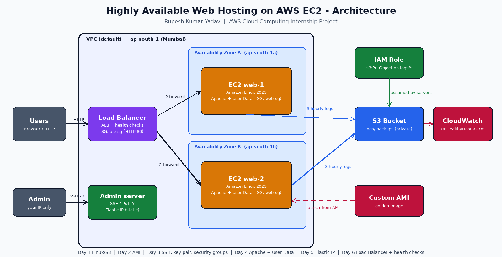
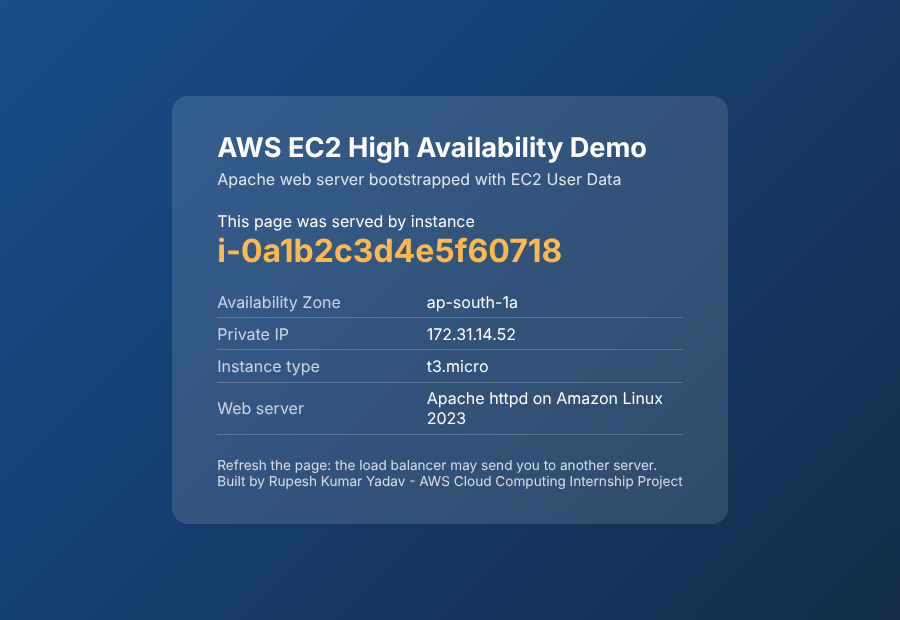
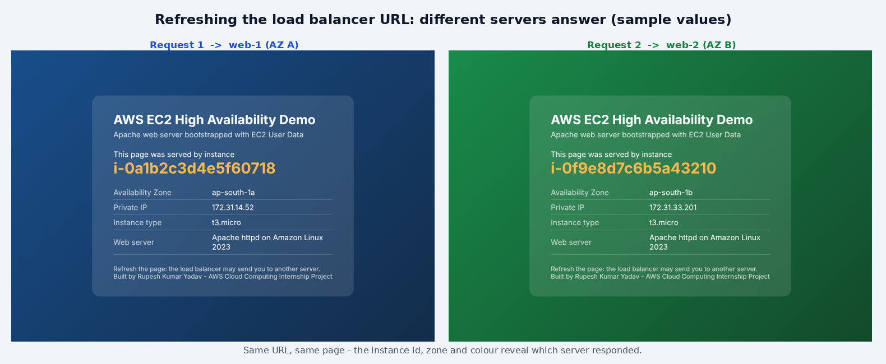

# 🌐 Highly Available Web Hosting on AWS EC2

> **AWS Cloud Computing Internship Project**
> **Author:** Rupesh Kumar Yadav

A hands-on project that combines the core AWS compute topics into one real architecture: **two Apache web servers on EC2 (Linux)**, bootstrapped automatically with **User Data**, placed in **different Availability Zones** behind a **Load Balancer with health checks**, plus an **admin server with an Elastic IP**, a **custom AMI** to scale out, and an **S3 bucket** that receives log backups through an **IAM role**.



## 📚 Topics Covered (Day 1 → Day 6)

| Day | Topic | Where it appears in this project |
|---|---|---|
| 1 | AWS basics, Linux, EC2, S3 | Amazon Linux servers, Linux commands, S3 log-backup bucket |
| 2 | EC2 practical, Windows & Linux, **AMI** | `scripts/create-ami-and-scale.sh` (golden image → new server); [Windows lab](docs/windows-ec2-rdp.md) |
| 3 | EC2 Linux launch & deploy, **SSH/PuTTY, Key Pair, Security Groups** | Key pair parameter, 3 security groups, [PuTTY guide](docs/putty-ssh-guide.md) |
| 4 | EC2 **web server: Apache + bootstrap script** | `scripts/bootstrap-userdata.sh` (User Data) |
| 5 | **Elastic IP** (public vs static IP) | Admin server with an Elastic IP in the template |
| 6 | **Load Balancer, ELB, EC2, health checks** | Application Load Balancer + target group health checks |

Details: [docs/learning-map.md](docs/learning-map.md)

## ✨ What the Project Does

- Launches **2 web servers** that install Apache and publish a page showing *which server answered* (instance ID, AZ, private IP)
- A **load balancer** spreads traffic across both servers and removes unhealthy ones using `/health.html`
- **Security groups** follow least privilege: web servers accept HTTP **only from the load balancer**, SSH **only from your IP**
- **Elastic IP** gives the admin server a fixed address that survives stop/start
- **Custom AMI** → launch a third server identical to the first and register it with the load balancer
- Servers upload Apache logs **hourly to S3** using an **IAM role** (no access keys stored on servers)
- **IMDSv2 enforced**, S3 bucket private + encrypted, **CloudWatch alarm** for unhealthy hosts
- Everything is **Infrastructure as Code** (CloudFormation) and deletes with one command

## 📁 Project Structure

```
aws-ec2-ha-web-hosting/
├── README.md
├── LICENSE
├── .gitignore
├── infrastructure/
│   ├── template.base.yaml        # CloudFormation (edit this)
│   ├── build_template.py         # injects the bootstrap script -> template.yaml
│   └── template.yaml             # generated, ready to deploy
├── scripts/
│   ├── bootstrap-userdata.sh     # Day 4: EC2 User Data (Apache + S3 backup cron)
│   ├── deploy.sh                 # one-command deploy
│   ├── create-ami-and-scale.sh   # Day 2: AMI + scale out
│   ├── test-load-balancing.sh    # Day 6: prove load balancing
│   └── cleanup.sh                # delete everything
├── tests/
│   └── test_project.py           # static checks (no AWS needed)
├── docs/
│   ├── learning-map.md
│   ├── architecture.md
│   ├── step-by-step-console-guide.md   # build it by hand, Day 1-6
│   ├── putty-ssh-guide.md
│   ├── windows-ec2-rdp.md
│   ├── linux-commands-cheatsheet.md
│   ├── troubleshooting.md
│   ├── cost-and-cleanup.md
│   └── interview-questions.md
└── screenshots/
    ├── README.md                 # what to capture
    └── *.png
```

## 🚀 Quick Start

**Prerequisites:** an AWS account, [AWS CLI](https://docs.aws.amazon.com/cli/latest/userguide/getting-started-install.html) configured (`aws configure`), Python 3, and an **EC2 key pair** in your region (create it in *EC2 → Key Pairs*, download the `.pem`).

```bash
git clone https://github.com/<your-username>/aws-ec2-ha-web-hosting.git
cd aws-ec2-ha-web-hosting

python -m unittest discover -s tests -v          # optional checks (needs: pip install pyyaml)

chmod +x scripts/*.sh
./scripts/deploy.sh my-key-pair ap-south-1       # ~5 minutes

./scripts/test-load-balancing.sh ap-south-1      # see requests split across servers
./scripts/create-ami-and-scale.sh ap-south-1     # optional: AMI + third server
./scripts/cleanup.sh ap-south-1                  # ALWAYS clean up when finished
```

Prefer to learn by clicking? Follow [docs/step-by-step-console-guide.md](docs/step-by-step-console-guide.md).

### Connect to a server

```bash
chmod 400 my-key-pair.pem
ssh -i my-key-pair.pem ec2-user@<AdminElasticIp>      # Windows users: see the PuTTY guide
```

## 🖼️ Screenshots

| What it shows | Preview |
|---|---|
| Web page served by one instance (rendered from the real bootstrap script, sample values) |  |
| Two servers, two colours: what refreshing the load balancer URL looks like (sample values) |  |
| EC2 key pair |  |
| Security groups (inbound rules) |  |
| EC2 instances running in two AZs |  |
| SSH / PuTTY session |  |
| Apache running (`systemctl status httpd`) |  |
| Elastic IP associated with admin server |  |
| Custom AMI |  |
| Target group - all targets healthy |  |
| Load balancer + browser on its DNS name |  |
| S3 bucket with uploaded logs |  |
| CloudFormation stack `CREATE_COMPLETE` |  |

Images `03`–`13` are labeled placeholders until you replace them with screenshots from your own AWS account — see [screenshots/README.md](screenshots/README.md).

## 🔐 Security Decisions

- SSH (port 22) allowed **only from your IP**, never `0.0.0.0/0`
- Web servers reachable on port 80 **only through the load balancer** (security group references the ALB group)
- **IAM role** with `s3:PutObject` on `logs/*` only — no access keys on instances
- **IMDSv2 required**, S3 **Block Public Access** + encryption on
- Optional **Session Manager** access (SSM role attached) so SSH isn't the only way in

## 💰 Cost Warning

Load balancers, running instances and public IPv4 addresses (including Elastic IPs) are billed while they exist, and free-tier terms depend on when your account was created. Check the [pricing pages](https://aws.amazon.com/pricing/), set a **budget alert**, and run `./scripts/cleanup.sh` right after your demo. See [docs/cost-and-cleanup.md](docs/cost-and-cleanup.md).

## 🧠 What I Learned

- Launching and securing EC2 instances (key pairs, security groups, SSH)
- Automating server setup with User Data / bootstrap scripts
- Creating AMIs and scaling out from a golden image
- Public IP vs Elastic IP, and why static addresses matter
- Load balancing, target groups and health checks for high availability
- Using IAM roles instead of credentials, and S3 for backups
- Infrastructure as Code with CloudFormation

## 🔭 Future Improvements

- Replace the fixed instances with an **Auto Scaling Group** + scaling policy
- **HTTPS** with ACM certificate and Route 53 custom domain
- Move web servers to **private subnets** with a NAT gateway and use the admin server as a bastion
- Centralised logs with the **CloudWatch Agent**
- CI/CD with GitHub Actions (OIDC)

## 👤 Author

**Rupesh Kumar Yadav** — AWS Cloud Computing Intern
GitHub: `https://github.com/rupeshyadav10/<Rupesh Kumar Yadav>` 

## 📄 License

MIT — see [LICENSE](LICENSE).
